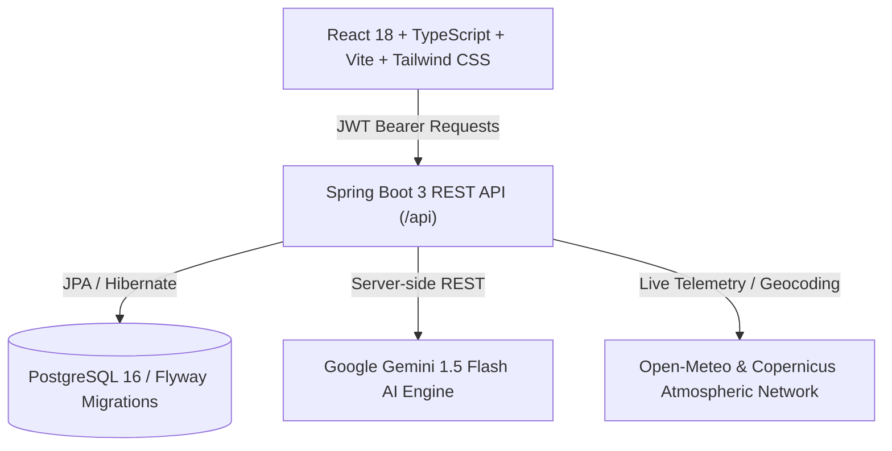

# AIRWISE AI — Urban Air Quality & Personalization Platform

> **"Breathe smarter. Live better."**

[](https://adoptium.net)
[](https://spring.io/projects/spring-boot)
[](https://react.dev)
[](https://www.typescriptlang.org)
[](https://tailwindcss.com)
[](https://www.docker.com)
[](LICENSE)

---

## 01. Executive Overview

**AirWise AI** is a production-quality, climate-tech urban air intelligence platform designed to help families, students, working professionals, athletes, and senior citizens make informed daily decisions during severe winter smog and urban atmospheric pollution.

Unlike static dashboards or generic chatbot templates, AirWise AI bridges the gap between **live atmospheric satellite/ground telemetry** and **personalized behavioral protection**.

---

## 02. Visual Identity & Editorial Design System

AirWise AI follows a **Swiss Editorial meets Scandinavian Climate Minimalism** visual philosophy.

### Brand Color Tokens
| Token | Hex | Role | Usage |
| :--- | :--- | :--- | :--- |
| **Primary Background** | `#F7F7F2` | Warm Off-White / Sand | Background canvas, soft natural paper feel |
| **Primary Text** | `#20221F` | Deep Charcoal | High contrast editorial readability |
| **Secondary Background** | `#E7EDE3` | Soft Sage | Section bands, active nav states, chips |
| **Primary Accent** | `#C5F36B` | Electric Lime | High-priority CTAs, focus indicators, badges |
| **Secondary Accent** | `#496B50` | Muted Forest Green | Environmental charts, icons, subheadings |
| **Supporting Tone** | `#DCEAF0` | Soft Sky Blue | Atmosphere tiles, humidity cards |
| **Surface** | `#FFFFFF` | Pure White | Elevated metric cards with subtle borders |

### Typography Hierarchy
1. **Headings:** `Space Grotesk` (700, 600, 500) — Bold, distinctive, modern editorial character.
2. **Body & Controls:** `DM Sans` (400, 500, 700) — High legibility.
3. **Large Metrics / AQI:** `Manrope` (800, 700) — High numerical visual impact.
4. **Technical & Metadata:** `IBM Plex Mono` (400, 500) — Coordinates, sensor timestamps, concentrations.

---

## 03. Architecture & Tech Stack



- **Frontend:** React 18, TypeScript, Vite, Tailwind CSS, Lucide React, Recharts, React-Leaflet, Framer Motion, TanStack Query.
- **Backend:** Java 21, Spring Boot 3.3.4, Spring Security (JWT), Spring Data JPA, Hibernate, Bean Validation, Flyway, Springdoc OpenAPI 3.
- **Database:** PostgreSQL 16 (production/Docker) & H2 in-memory (instant dev & testing).
- **External Integrations:**
  - Real Global Air Quality API (Open-Meteo & Copernicus Global Network) delivering live PM2.5, PM10, NO₂, O₃, SO₂, CO, and AQI for every city worldwide.
  - Global Geocoding API for instant location lookup.
  - Google Gemini 1.5 Flash API for AI chat and routine synthesis with clinical heuristic fallback engine.

---

## 04. Core Modules & Product Features

### A. Public Landing Page
- Minimal editorial navigation with original air current & leaf SVG logo.
- Hero headline: *"Know your air. Own your day."*
- Interactive live AQI preview with global search autocomplete.
- Science section detailing the atmospheric physics of winter temperature inversions and PM2.5 alveolar penetration.

### B. Main Dashboard
- Time-of-day greeting (*"Good morning / afternoon / evening"*).
- Custom SVG circular arc gauge with live US AQI score.
- 6-Pollutant breakdown grid (PM2.5, PM10, NO₂, O₃, SO₂, CO) with WHO benchmark limits and health statuses.
- 24-hour Diurnal Trend Chart (Recharts) visualizing morning/evening smog spikes.
- 7-Day multi-pollutant forecast cards.
- Outdoor Activity Safety Matrix (Running, Cycling, Walking, Children & Seniors).
- Daily Exposure Inhalation Dosimetry Calculator (estimating cumulative inhaled micrograms of PM2.5).

### C. Conversational AI Assistant
- Live consultation considering location, current AQI, and user persona (Student, Working Pro, Parent, Senior, Athlete).
- Server-side integration with Gemini 1.5 Flash + resilient clinical rule engine fallback.
- Suggested prompt pills and clear attribution distinguishing measured sensors from AI advisory.

### D. Smart Daily Routine Planner
- Time-slotted schedule: Morning Exercise, Commute, Midday Walk, Errands, Evening Exercise.
- Identifies exposure level (LOW, MODERATE, HIGH, SEVERE) and suggests safer alternatives.
- Interactive checkboxes with completion tracking and celebratory confetti animations.

### E. Indoor Air Quality Guide & Engineering Tools
- Window-opening feasibility recommendations based on outdoor AQI and solar convection hours.
- Interactive CADR Sizing Calculator: computes minimum Clean Air Delivery Rate (m³/h & CFM) for custom room dimensions based on 4-5 Air Changes per Hour (ACH).
- Scientific Houseplant Reality Check: dispels common myths regarding the 1989 NASA chamber study vs real homes.
- Room-by-room interactive checklist (Bedroom, Kitchen, Living Room, Nursery) with progress audit.

### F. Eco-Friendly Commute & Personal Impact
- Multi-modal commute comparison (Underground Metro, Electric Bus, Carpool, Bicycle, Solo Car).
- Transparent emission methodology: calculations based on DEFRA and CPCB urban transport standards (192g CO₂/km car baseline vs 38g metro vs 54g bus).
- Personal clean-air ledger to log trips and track cumulative CO₂ saved, PM2.5 avoided, and trees equivalent.

### G. Global Air Quality Map
- Interactive Leaflet map styled in minimalist aesthetic matching the paper-cream palette.
- Real AQI color-coded markers for major world capitals (Delhi, Mumbai, Beijing, Tokyo, London, Paris, New York, Los Angeles, etc.).
- Side-by-side comparative analytics drawer.

### H. User Profile & Preferences
- JWT Authentication (Register, Login, Demo Account autofill).
- Household vulnerability switches (Infants, Senior Citizens, Asthma/Respiratory sensitivities).
- Commute and notification preferences.
- Saved recommendation bookmarks.

---

## 05. Quick Start & Local Execution

### Prerequisites
- Docker & Docker Compose **OR**
- Java 21 JDK & Node.js 18+

### Option A: Run via Docker Compose (Recommended)

1. Clone or navigate to the repository directory.
2. Launch all services:
```bash
docker compose up --build -d
```
3. Open your browser:
   - **Frontend:** [http://localhost:80](http://localhost:80) or [http://localhost:3000](http://localhost:3000)
   - **Backend API:** [http://localhost:8080/api](http://localhost:8080/api)
   - **Swagger / OpenAPI Documentation:** [http://localhost:8080/swagger-ui.html](http://localhost:8080/swagger-ui.html)
   - **Actuator Health Check:** [http://localhost:8080/actuator/health](http://localhost:8080/actuator/health)

---

### Option B: Run Standalone for Local Development

#### 1. Backend (Spring Boot 3 + Java 21)
```powershell
# In the backend directory
mvn spring-boot:run
```
*The dev profile starts automatically with an in-memory PostgreSQL-compatible H2 database and pre-seeds a demo account (`demo@airwise.ai` / `password123`).*

#### 2. Frontend (React + Vite)
```powershell
# In the frontend directory
npm install
npm run dev
```
*Frontend runs on [http://localhost:5173](http://localhost:5173).*

---

## 06. Demo Credentials

You can explore the authenticated features immediately using the pre-seeded account or click the **"Autofill Demo User"** button in the sign-in modal:
- **Email:** `demo@airwise.ai`
- **Password:** `password123`

---

## 07. Automated Testing

### Backend Unit Tests (JUnit 5)
```powershell
# Runs targeted unit tests
mvn test "-Dtest=AirQualityServiceTest,SustainabilityServiceTest" -f backend/pom.xml
```

### Frontend Component & Logic Tests (Vitest)
```powershell
cd frontend
npm test
```

### Frontend Production Build Verification
```powershell
cd frontend
npm run build
```

---

## 08. REST API Documentation (Swagger)

When the backend is active, view the interactive OpenAPI specification at:
`http://localhost:8080/swagger-ui.html`

Key REST endpoints:
- `POST /api/auth/register` — Register account
- `POST /api/auth/login` — Authenticate and receive JWT
- `GET /api/users/me` — Authenticated profile & preferences
- `GET /api/air-quality/current?city=...` — Live atmospheric telemetry
- `POST /api/ai/chat` — Conversational AI consultation
- `GET /api/routines/today` — Daily defense schedule
- `GET /api/indoor/public-guidance` — Ventilation verdict & room checklist
- `GET /api/impact/calculate?distanceKm=...` — Commute emission comparison
- `GET /api/locations/search?query=...` — City geocoding autocomplete

---

## 09. License

Licensed under the Apache License, Version 2.0.
